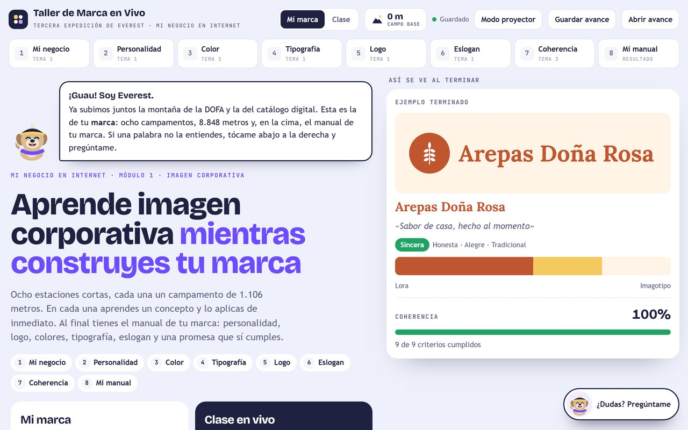
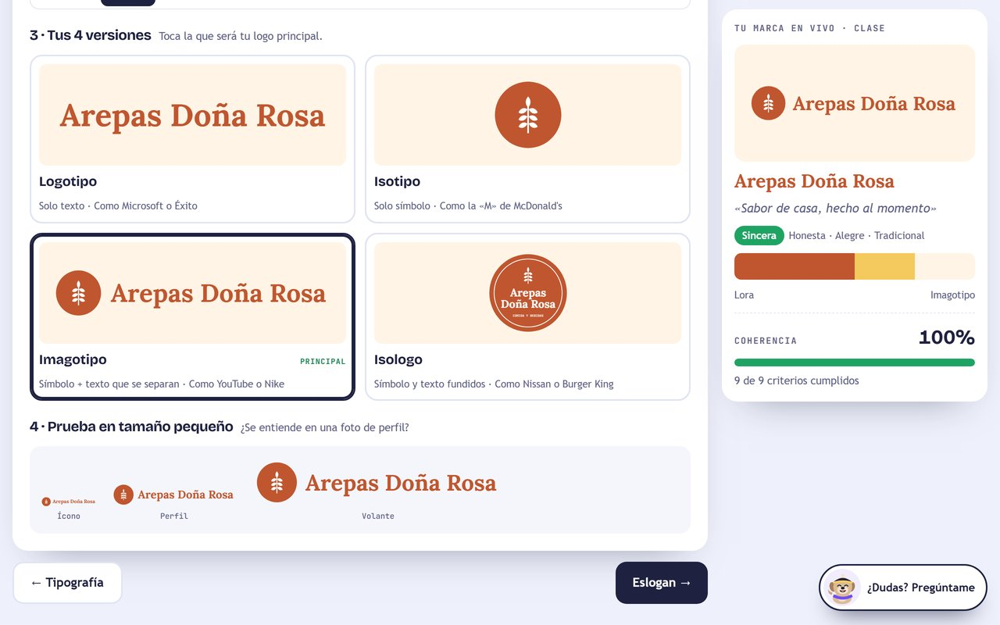
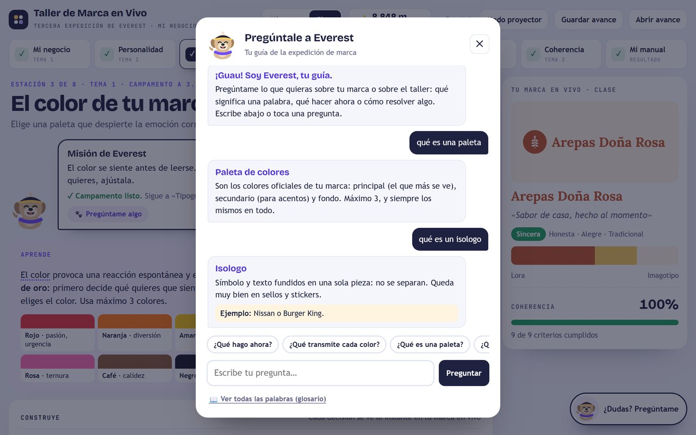
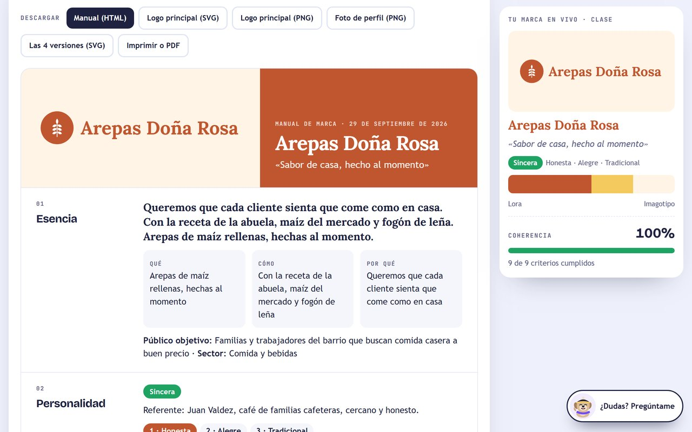
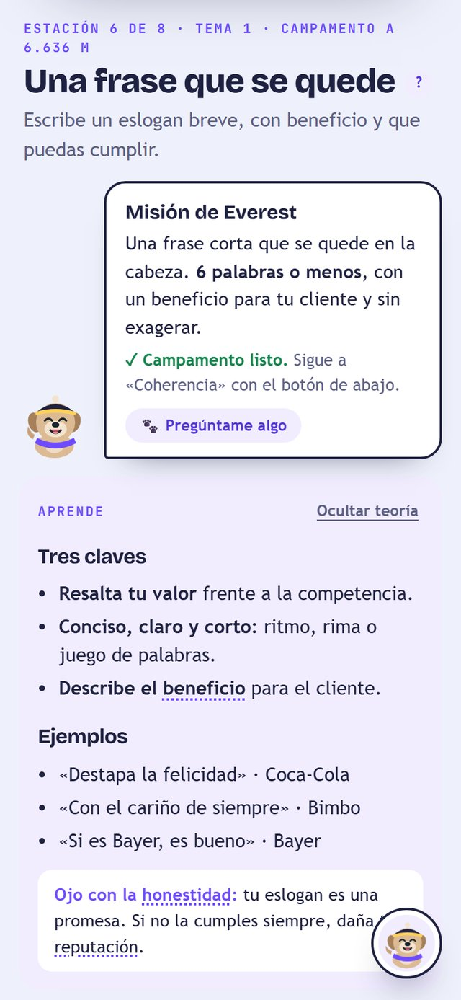

<div align="center">

<picture>
  <source media="(prefers-color-scheme: dark)" srcset="assets/mys-logo-blanco.png">
  
</picture>

# 🎨 Taller de Marca en Vivo

### Una clase de imagen corporativa que termina con el manual de marca del emprendedor

**MyS SinergiaaS** — Consultoría y Tecnología
*Automatiza. Escala. Vende.*

[](https://taller-marca-vivo.vercel.app)
[](https://mac-saenz-portafolio.vercel.app)
[](https://wa.me/573148788974)

`En producción` · `Sin registro` · `Sin instalación` · `Manual de marca descargable` · `Marca blanca`

</div>

---

## El problema

Casi todos los emprendedores empiezan su marca por el logo. Piden uno «bonito»,
escogen los colores que les gustan y buscan una frase que suene bien. Meses
después la marca no dice nada: el logo no se entiende en la foto de perfil de
WhatsApp, cada volante sale con colores distintos y el eslogan promete algo que
el negocio no siempre cumple.

En el aula pasa lo mismo al revés. La clase de imagen corporativa suele ser
teoría: personalidad de marca, psicología del color, tipos de logo. El
estudiante toma apuntes, pero su marca sigue igual.

## La solución

**El Taller de Marca en Vivo junta las dos cosas: en cada estación se aprende un
concepto y se aplica de inmediato a la marca propia.**

<div align="center">

</div>

Son ocho estaciones, cada una un campamento de una expedición de **8.848
metros**. La guía es **Everest**, el mismo perro de montaña de
[Cumbre DOFA](https://cumbre-dofa.vercel.app) y de
[La Ruta de la Cima Digital](https://ruta-cima-digital.vercel.app).

```
Mi negocio → Personalidad → Color → Tipografía → Logo → Eslogan → Coherencia → Mi manual
```

A la derecha, la tarjeta **«Tu marca en vivo»** cambia con cada decisión y un
medidor de coherencia avisa cuando algo no encaja: un color que no va con la
personalidad, un eslogan de nueve palabras o una promesa exagerada.

### El logo, en cuatro versiones
El estudiante elige un símbolo y el taller dibuja su marca como **logotipo,
isotipo, imagotipo e isologo**, con su tipografía y su paleta. Luego la prueba
en tamaño pequeño, como se verá en WhatsApp.

<div align="center">

</div>

### Everest, el guía que responde
Cada estación abre con la misión de Everest y lo que falta para completarla.
Las palabras técnicas vienen subrayadas: al tocarlas, Everest las explica con un
ejemplo. También se le puede escribir cualquier duda («¿qué es un isologo?»,
«¿qué hago ahora?») y hay un glosario con más de 50 conceptos del módulo.

<div align="center">

</div>

### En la cima: el manual de marca
Esencia, personalidad, logo con usos correctos e incorrectos, colores con sus
códigos, tipografía, aplicaciones (redes, WhatsApp, tarjeta y sticker) y la
promesa de valor. Se descarga en HTML, se imprime o se guarda en PDF, junto con
el logo en SVG y PNG y la foto de perfil lista para subir.

<div align="center">

</div>

<div align="center">

</div>

---

## Lo que lo hace distinto

| | |
|---|---|
| 📘 **Sale un producto, no una nota** | El estudiante termina con su manual de marca, su logo en cuatro versiones y su foto de perfil. |
| 👀 **Marca en vivo** | Cada respuesta cambia al instante el logo, la paleta y el medidor de coherencia. |
| ✅ **Coherencia revisada** | Nueve criterios avisan si el color, la letra o el eslogan no van con la personalidad elegida, y cada aviso lleva a corregirlo. |
| 🐕 **Everest, el guía** | Explica cada concepto con ejemplos, responde dudas y dice qué falta en cada estación. |
| ⛰️ **Altitud y niveles** | Cada estación completa suma 1.106 metros hasta la cima, del «Campo base» a «Marca en la cima». |
| 🧑‍🏫 **Modo clase** | El grupo construye en el proyector la marca de un negocio de ejemplo sin tocar la marca personal de nadie. |
| 🔒 **Nada sale del navegador** | Sin registro. Lo que escribe cada persona se guarda en su propio dispositivo y puede llevárselo en un archivo. |
| 🏷️ **Arquitectura white-label** | La misma experiencia con la identidad de cada institución, curso o programa de emprendimiento. |

---

## Para quién

- **Docentes y programas de emprendimiento** que enseñan imagen corporativa y
  quieren que la clase termine con algo que el estudiante use.
- **Cámaras de comercio, incubadoras y fundaciones** que acompañan a pequeños
  negocios y necesitan talleres prácticos y medibles.
- **Emprendedores** que quieren ordenar su marca con método antes de pagar un
  diseño.

---

## Probarlo

No se instala nada. No hay registro. Se abre el enlace y se empieza:

### **→ [taller-marca-vivo.vercel.app](https://taller-marca-vivo.vercel.app)**

---

## Modalidades de implementación

| Modalidad | Para quién |
|---|---|
| **Uso directo** | La herramienta pública, tal como está, abierta para cualquier aula. |
| **Marca blanca** | Su identidad visual, su dominio y sus contenidos de curso. |
| **Implementación a la medida** | Nuevas estaciones, otros temas de formación o integración con su plataforma. |
| **Taller facilitado** | La experiencia completa, dirigida en su institución por MyS SinergiaaS. |

Para cotizar cualquiera de ellas: **[hablemos por WhatsApp](https://wa.me/573148788974)**.

---

## ⚖️ Aviso legal y comercial

> **Este repositorio es una exhibición de portafolio.**
>
> Publica el **resultado** del producto (qué resuelve, cómo se usa y qué
> entrega) con fines comerciales y de demostración de capacidad técnica.
> **No contiene el código fuente de la aplicación.**
>
> El código fuente, el contenido pedagógico, las reglas de coherencia, el
> generador de logos y el generador del manual son **propiedad intelectual
> exclusiva de MyS SinergiaaS**. No se distribuyen, licencian ni publican bajo
> ninguna licencia de código abierto.
>
> El acceso público a [taller-marca-vivo.vercel.app](https://taller-marca-vivo.vercel.app)
> se ofrece para evaluación, demostración y uso en el aula. Su uso comercial,
> reventa, ingeniería inversa o incorporación a un producto de terceros requiere
> acuerdo escrito previo.
>
> © 2026 MyS SinergiaaS. Todos los derechos reservados.

---

<div align="center">

## Hablemos

**Mac Eduardo Sáenz Martínez**
Dirección de Proyectos · Arquitectura de Soluciones · Transformación Digital
Valencia, Córdoba — Colombia

[](https://mac-saenz-portafolio.vercel.app)
[](https://www.linkedin.com/in/macsaenz)
[](https://github.com/macsaenz07)
[](mailto:saenzmartinez.mac@gmail.com)

**¿Necesita esta experiencia con su marca, o un producto a la medida de su programa?**

[Escríbame por WhatsApp](https://wa.me/573148788974) · +57 314 878 8974

</div>
